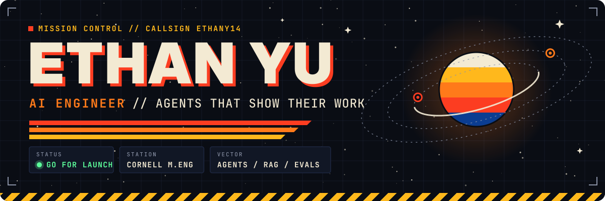
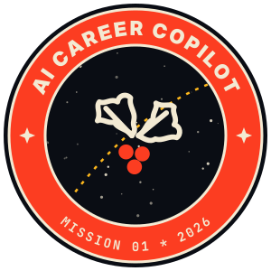
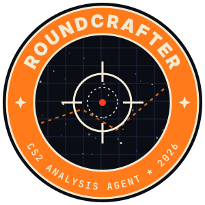
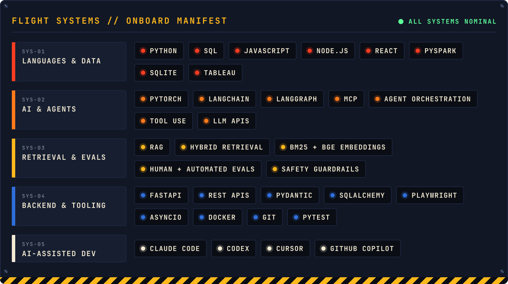

<p align="center">
  
</p>

<p align="center">
  <a href="https://www.linkedin.com/in/ethan-yu-091114291"></a>
  <a href="https://ethany14.github.io/Eregion-Job-Finding-Agent/"></a>
  <a href="https://github.com/ethany14?tab=followers"></a>
</p>


I build **AI agents that do real work and keep the receipts**: they search,
score, fill in forms and coach. Before anything they say reaches a person, it
is checked against evidence. A person always holds the launch key.

```text
> MISSION CONTROL // ETHANY14 ............................. LINK OK
  CREW ............ Ethan Yu
  ROLE ............ AI Engineer: agents, RAG, evals
  STATION ......... Cornell University, M.Eng. Systems Engineering (exp. May 2027)
  PRIOR ........... UW–Madison, B.A. Computer Science (Dec 2025)
  DIRECTIVE ....... every claim traced to evidence; humans make the final call
  STATUS .......... ● GO FOR LAUNCH
```


<table>
  <tr>
    <td width="50%" align="center" valign="top">
      <a href="https://github.com/ethany14/Eregion-Job-Finding-Agent"></a>
      <h3><a href="https://github.com/ethany14/Eregion-Job-Finding-Agent">Eregion</a></h3>
      <sub><b>AI CAREER COPILOT</b> · 2026 →</sub>
    </td>
    <td width="50%" align="center" valign="top">
      <a href="https://github.com/ethany14/Cs2-Roundcrafter"></a>
      <h3><a href="https://github.com/ethany14/Cs2-Roundcrafter">RoundCrafter</a></h3>
      <sub><b>CS2 ANALYSIS AGENT</b> · 2026 →</sub>
    </td>
  </tr>
  <tr>
    <td valign="top">
      A local job-search agent. It searches company boards and LinkedIn, scores fit, tailors your materials and fills in
      applications in Chrome up to the review page, and never submits without you.
      <br><br>
      <b>TELEMETRY</b>
      <br>▸ <b>−39.8%</b> active runtime from deterministic autofill with read-back verification
      <br>▸ <b>89% → 95%</b> agreement with human labels on eligibility checks
      <br>▸ <b>−43%</b> request size from context compaction with retrievable archives
      <br><br>
      <code>FastAPI</code> <code>Pydantic</code> <code>SQLAlchemy</code> <code>Playwright</code> <code>MCP</code>
    </td>
    <td valign="top">
      A CS2 coaching agent. It pairs replay-based Python analysis with hybrid RAG, and its guardrails check source quotes
      before accepting a tactical fact. <i>Every round, on the record.</i>
      <br><br>
      <b>TELEMETRY</b>
      <br>▸ Recall@1 <b>0.58 → 0.65</b> with hybrid BM25 + BGE retrieval
      <br>▸ <b>−9.1%</b> displacement error from a PyTorch GRU ensemble that predicts player positions
      <br>▸ <b>1,000+</b> views on the product video, with user feedback fed back into retrieval
      <br><br>
      <code>PyTorch</code> <code>Hybrid RAG</code> <code>Node.js</code> <code>SQLite</code>
    </td>
  </tr>
</table>


<p align="center">
  
</p>


| T-STAMP | STATION | ROLE | LOG ENTRY |
| :-- | :-- | :-- | :-- |
| `2026 → NOW` | **Selected projects** | Builder | Eregion and RoundCrafter: agents, RAG, browser automation, evals |
| `2022` | **VNET Group** · Beijing | AI Infrastructure Data Analyst Intern | Python and SQL datasets on data-center markets in Thailand, Singapore and Malaysia; Tableau dashboards comparing capacity, power efficiency, latency and pricing |

| GRADUATION | ACADEMY | QUALIFICATION |
| :-- | :-- | :-- |
| `MAY 2027 (EXP.)` | **Cornell University** | M.Eng., Systems Engineering |
| `DEC 2025` | **University of Wisconsin–Madison** | B.A., Computer Science |


Channel open. Reach me on **[LinkedIn](https://www.linkedin.com/in/ethan-yu-091114291)**, or open an issue on any of my repos.

<p align="center">
  
</p>
