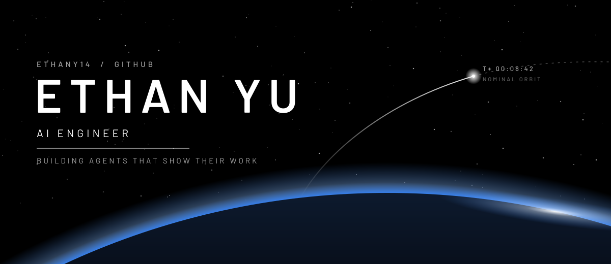
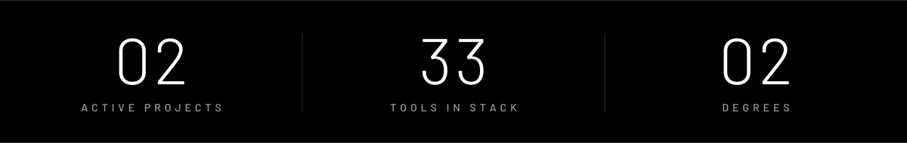
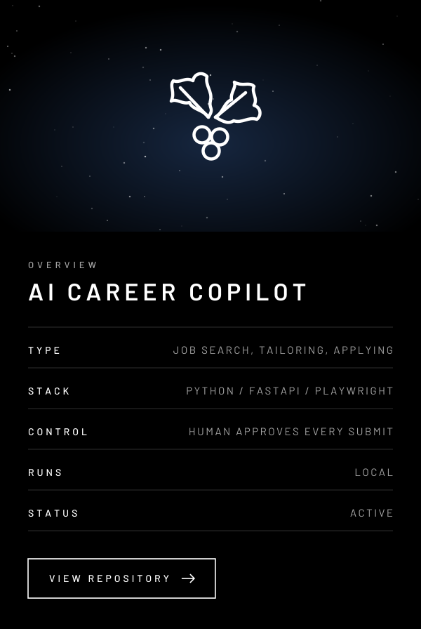
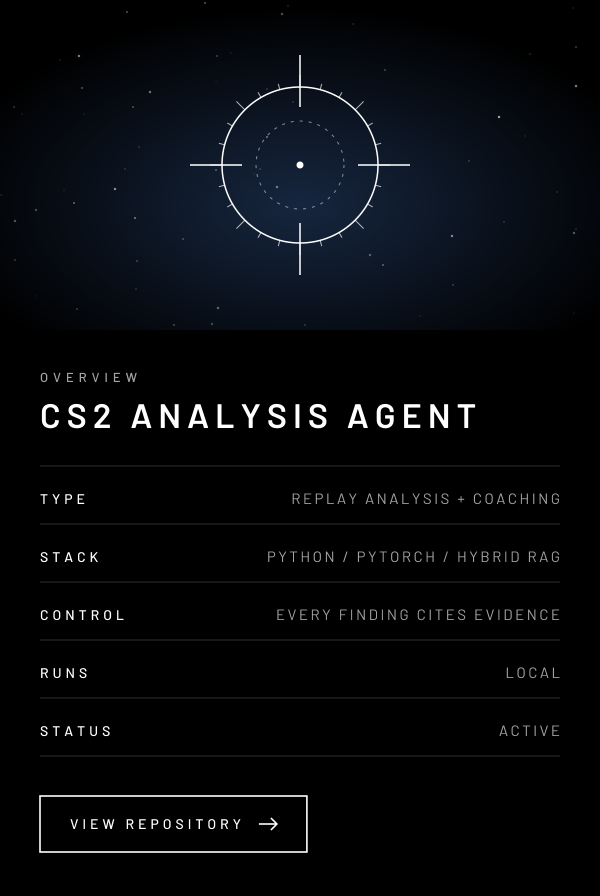
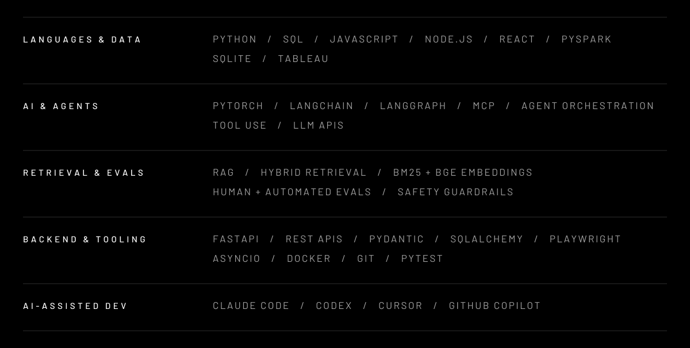

   
  

  
  

I build AI agents that do real work and keep the receipts. Every claim they make
is checked against evidence before it reaches a person, and the final call always
stays with a human.

<table>
  <tr>
    <td width="50%" valign="top">
      
      
<a href="https://github.com/ethany14/Eregion-Job-Finding-Agent"><b>EREGION&nbsp;&nbsp;→</b></a>

    </td>
    <td width="50%" valign="top">
      
      
<a href="https://github.com/ethany14/Cs2-Roundcrafter"><b>ROUNDCRAFTER&nbsp;&nbsp;→</b></a>

    </td>
  </tr>
</table>

  

| INSTITUTION | DEGREE |
| :-- | :-- |
| **CORNELL UNIVERSITY** | M.Eng., Systems Engineering |
| **UNIVERSITY OF WISCONSIN–MADISON** | B.A., Computer Science |

 

  ETHANY14 © 2026 &nbsp;&nbsp;·&nbsp;&nbsp; <a href="https://www.linkedin.com/in/ethan-yu-091114291">LINKEDIN</a> &nbsp;&nbsp;·&nbsp;&nbsp; <a href="mailto:yzyrtk@gmail.com">YZYRTK@GMAIL.COM</a> &nbsp;&nbsp;·&nbsp;&nbsp; <a href="https://github.com/ethany14">GITHUB</a>

