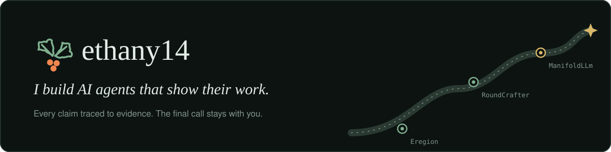

  <picture>
    <source media="(prefers-color-scheme: light)" srcset="assets/banner-light.svg">
    
  </picture>

  
  
  
  
  
  

## 👋 Hi there

I build **agents that do real work and keep the receipts**. Each project has a
model doing real work: reading job postings, filling in applications,
reviewing a CS2 match. Each one also has to back up what it says: a claim
without evidence gets checked or dropped, and nothing final happens without a
person signing off.

- 🌿 Building **[Eregion](https://github.com/ethany14/Eregion-Job-Finding-Agent)**, a local job-search agent that searches, scores, tailors and applies.
- 🎯 Making **[RoundCrafter](https://github.com/ethany14/Cs2-Roundcrafter)**, a CS2 demo analyst whose findings must cite evidence.
- 🧪 Researching **[ManifoldLLm](https://github.com/ethany14/ManifoldLLm)**, manifold representations of an updateable personality state.

## 🎓 Education

| | |
| :-- | :-- |
| **Cornell University** | Master of Engineering (M.Eng.) |
| **University of Wisconsin–Madison** | B.A., Computer Science |

## 🛠️ Featured work

<table>
  <tr>
    <td colspan="2" valign="top">
      <a href="https://github.com/ethany14/Eregion-Job-Finding-Agent">
        <picture>
          <source media="(prefers-color-scheme: light)" srcset="https://raw.githubusercontent.com/ethany14/Eregion-Job-Finding-Agent/main/frontend/site/assets/readme/banner-light.webp">
          
        </picture>
      </a>
      <h3>🌿 <a href="https://github.com/ethany14/Eregion-Job-Finding-Agent">Eregion</a></h3>
      
<i>Your job search, in one conversation.</i>

      

        A job-search agent that runs on your own computer. It searches 118 verified company boards and LinkedIn, reads
        each posting in full and sorts the jobs into fit tiers, listing the gaps for each one. It also tailors your resume and
        cover letter, checking every claim against your real experience, and fills in Workday and other applications in
        Chrome up to the review page. <b>It never submits without you.</b>
      

      

        
        
        
        
        
        
      

    </td>
  </tr>
  <tr>
    <td width="50%" valign="top">
      <h3>🎯 <a href="https://github.com/ethany14/Cs2-Roundcrafter">RoundCrafter</a></h3>
      
<i>Every round, on the record.</i>

      

        A Counter-Strike 2 demo analyzer. It turns <code>.dem</code> files into a local 2D replay, multi-round heatmaps,
        a tactic board, Steam career stats and a utility lab. Its AI analyst has to cite an evidence ID for every finding,
        and a local audit removes any claim the data doesn't support.
      

      

        
        
        
        
      

    </td>
    <td width="50%" valign="top">
      <h3>🧪 <a href="https://github.com/ethany14/ManifoldLLm">ManifoldLLm</a></h3>
      
<i>Can a manifold hold a personality that updates?</i>

      

        A research project on representing an updateable digital-personality state from repeated observations of the same
        people. It uses a learned encoder–decoder with decoder-induced Riemannian geometry, evaluated on 300-item IPIP
        responses. The experiments are reproducible and the team shares result folders.
      

      

        
        
        
      

    </td>
  </tr>
</table>

## 🧰 Toolbox

  
  
  
  
  
  
  
  
  

## 🧭 How I build

| | |
| :-- | :-- |
| 🔍 **Evidence first** | If a model says it, a source has to back it up. Eregion checks every claim against your resume, and RoundCrafter's analyst cites the data. |
| ✋ **People make the final call** | Agents do the paperwork, and people decide. Approving materials and pressing submit stay with you. |
| 📏 **Measured, not hyped** | Live runs have fixed budgets, and Eregion's [evaluation report](https://github.com/ethany14/Eregion-Job-Finding-Agent/blob/main/docs/evaluation-report.md) includes what failed. |
| 🏠 **Local by default** | Eregion and RoundCrafter run on your own machine, and your data stays there. |

## 📫 Get in touch

The best place to reach me is **[LinkedIn](https://www.linkedin.com/in/ethan-yu-091114291)**, or open an issue on any of my repos.

   
   
  <i>A little less paperwork. A step closer.</i>

